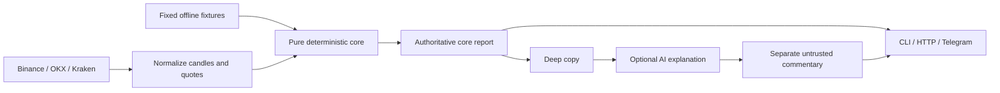

# Crypto Analyst

[](https://github.com/shibumi2906/bot_kripto/actions/workflows/tests.yml)


[](LICENSE)

**Deterministic market analysis with an optional AI explanation layer.**

A Python portfolio project demonstrating a functional core / imperative shell architecture.
The core computes a reproducible technical report; an LLM can explain it but never owns
the trading decision or numerical fields.

**Runs offline without accounts. Live mode uses real public Binance, OKX and Kraken data.**
No trades are executed. Data quality, market stress and planned position loss are reported
separately. Market stress is a versioned heuristic, not a calibrated probability of loss
or a claim of profitable performance.

## Five-minute demo

| Deterministic | Multi-source | AI-isolated |
| --- | --- | --- |
| Same inputs, same report and fingerprint | Binance, OKX and Kraken | Commentary cannot overwrite computed facts |

[Architecture](docs/ARCHITECTURE.md) · [Interview walkthrough](docs/DEMO.md) ·
[Русская инструкция](docs/OPERATIONS.md)

Python 3.13, from the repository root. PowerShell:

```powershell
python -m venv .venv
.\.venv\Scripts\python.exe -m pip install -r requirements.txt
.\.venv\Scripts\python.exe -m app analyze --mode demo --balance 1000
.\.venv\Scripts\python.exe -m pytest -q -p no:cacheprovider
```

On Linux/macOS use `.venv/bin/python` instead of `.\.venv\Scripts\python.exe`.

The demo is explicitly synthetic and fixed in time. Repeating it produces the same
`core` and `input_hash`. It needs no database, network access, Telegram token or OpenAI key.

Selected fields from the demo report (`--balance 1000`):

```json
{
  "engine_version": "technical-v2",
  "mode": "demo",
  "symbol": "BTCUSDT",
  "action": "HOLD",
  "risk": {
    "data_quality": {
      "history_coverage": "full",
      "quote_source_count": 3,
      "activity": "sufficient",
      "inactive_sources": [],
      "execution_ready": true
    },
    "market": {
      "score": 16.57,
      "level": "normal"
    },
    "position": null
  }
}
```

HOLD is a valid outcome, not a failed analysis. A calm market does not automatically
qualify for a trade; independent decision gates must pass.

## Live analysis

```powershell
.\.venv\Scripts\python.exe -m app analyze --mode live --symbol BTCUSDT
```

Supported pairs: BTCUSDT, ETHUSDT, SOLUSDT. Timeframe: 1h.
The collector requests 120 closed candles from each exchange in parallel.
It also collects current bid/ask quotes. Directional scenarios require at least two fresh
quotes, sufficient recent trading activity and acceptable spread/price drift.
Two fresh, independently supplied, synchronized histories are required.
Provider failures are visible; insufficient data results in an error, never a synthetic live report.

The November 14, 2026 BTCUSDT smoke test received all three exchanges with 120 candles,
without exchange API keys. Live availability is subject to network, region and provider limits.

## HTTP demonstration

```powershell
.\.venv\Scripts\python.exe -m uvicorn app.main:app --host 127.0.0.1 --port 8000
```

Open [Swagger UI](http://127.0.0.1:8000/docs) or [offline demo JSON](http://127.0.0.1:8000/analysis/demo).

```powershell
Invoke-RestMethod -Method Post -Uri http://127.0.0.1:8000/analysis -ContentType application/json -Body '{"symbol":"BTCUSDT","mode":"live","balance":1000,"risk_percent":0.5}'
```

| Endpoint | Behavior |
| --- | --- |
| GET /health | Process liveness |
| GET /analysis/demo | Reproducible offline report |
| POST /analysis | Validated demo/live analysis; 503 on inadequate source quality |

HTTP AI calls are disabled by default to avoid exposing your OpenAI budget.
This is a local demonstration server, without public-user authentication or rate limiting.

## What the core computes

- SMA20/SMA50, simple-window RSI14, simple-window ATR14, log-return volatility.
- Per-exchange trend, volume ratio, 24h return, close-to-close drawdown and worst-hour loss.
- Separate data-quality checks, market-stress components and planned position loss.
- An indicative ATR-based scenario with 2:1 reward/risk when conditions match.
- Optional BUY position size capped at available USDT balance and at most 1% planned risk.
- SHA-256 fingerprint of normalized input, analysis time, mode and sizing parameters.

SELL means reduce an existing spot position, not open a leveraged short.
Reference prices are last closed hourly prices. Scenario entry uses a current ask for BUY
or bid for SELL, with source and timestamp. Missing quotes, age over 30s, spread over 0.2%,
or price drift over 0.5% block scenarios. These snapshots do not guarantee execution.
Fees, order-book depth, slippage, news and on-chain factors are not modeled.

## Optional AI layer

For a new checkout, copy `.env.example` to `.env`; do not overwrite an existing file.
Set `OPENAI_API_KEY` locally. Never commit real keys.

```powershell
.\.venv\Scripts\python.exe -m app analyze --mode demo --explain
.\.venv\Scripts\python.exe -m app budget
.\.venv\Scripts\python.exe -m app doctor
```

The explicit `--explain` option makes an OpenAI request and may be billable.
The `doctor` command checks only model metadata and Telegram getMe. It neither generates
text nor sends messages and never prints credentials.
Model: `gpt-6.1-sol`, reasoning effort: low.
AI text appears only under `ai`; authoritative numbers remain under `core`.
Missing keys, API errors and exhausted budget leave the deterministic report available.

A conservative persistent SQLite ledger reserves input headroom plus maximum output before
every AI request. Local cap: **200,000 combined input/output tokens per UTC day**.
Reservations are not refunded, including failed/uncertain requests, so the usable quota is
deliberately smaller. All processes must share the same ledger. It does not account for other
applications using your OpenAI organization. Free-token eligibility must be verified in your
OpenAI project; a local budget does not establish eligibility.

## Telegram

Set `TELEGRAM_BOT_TOKEN` in `.env`, then:

```powershell
.\.venv\Scripts\python.exe -m app.bot
```

Commands: `/start`, `/demo BTCUSDT`, `/analyze BTCUSDT`.
Telegram uses the same core and does not call paid AI. Only one polling process per bot token.

## Architecture and review



| Area | Responsibility |
| --- | --- |
| app/domain | Pure functions and immutable input models; no I/O or clock |
| app/services/market_sources.py | Provider adapters, timeouts, normalization |
| app/services/analyst.py | Orchestration and AI isolation |
| app/services/token_budget.py | Atomic, persistent request admission |
| app/api/analysis.py | HTTP input validation and error mapping |
| app/__main__.py | CLI |
| tests | Core invariants, provider contracts, HTTP and AI isolation |

[Architecture and formulas](docs/ARCHITECTURE.md) ·
[Employer walkthrough](docs/DEMO.md) ·
[Russian operations guide](docs/OPERATIONS.md) ·
[Current specification](docs/TECHNICAL_SPEC.md) ·
[Implementation status](docs/IMPLEMENTATION_PLAN.md)

Earlier SaaS experiments (users, subscriptions, portfolio, payments, on-chain stub,
backtester) remain in the repository for history but are **not mounted in the v0.3 API**.
They are not presented as finished features. See [baseline audit](docs/CURRENT_STATE.md).

CI tests Python 3.13 on Windows and Linux without real credentials.
The status badge above links to the actual workflow results.

Local verification: **76 tests passed**, dependency checks passed, and the HTTP demo
responded with API v0.3.0 / policy technical-v2. Tests include hand-computed indicator
references and regressions for zero volume, smooth crashes, invalid time and stale quotes.

## License

[MIT](LICENSE).
